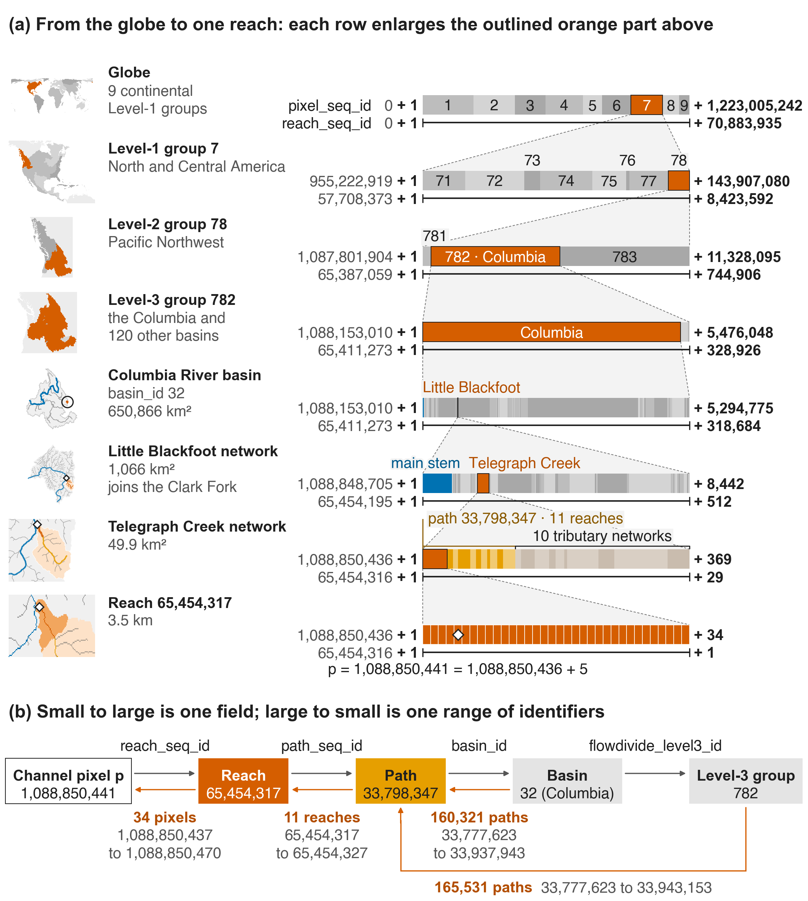

# FlowNest

FlowNest numbers the channel pixels of a D8 flow-direction grid depth first, so that the reaches, paths and network
upstream of any pixel are one range of integers.



*Every object, from the globe to one reach, is one range of numbers (MERIT Hydro at 1 km²): the Columbia, the Little
Blackfoot River and one reach of Telegraph Creek. Figure 5 of the FlowNest paper.*

## Install

```sh
git clone https://github.com/hellolulujiang/flownest.git
cd flownest
pip install -e ".[release]"
```

Python 3.9 or later. The `release` extra reads the released files; `crosswalks` adds gauges, MERIT-Basins and SWORD.

## Quick start

```python
from flownest import number_grid

n = number_grid(d8, upa, threshold=1.0, nodata=247)   # MERIT Hydro flow directions and upstream area (km²)
up = n.upstream(p)                                     # the channel pixels upstream of channel pixel p
catchment = (abs(n.raster) >= up.start) & (abs(n.raster) < up.stop)
```

`python examples/quickstart.py` runs a small made-up grid.

## Documentation

[User guide](docs/user-guide.md): numbering a grid, the released files, any threshold, upstream statistics,
crosswalks, tests, checks against the release and limits.

[](https://github.com/hellolulujiang/flownest/actions/workflows/tests.yml)

## Data products

FullNest, FlowNest on MERIT Hydro (90 m): [global files](https://doi.org/10.5281/zenodo.24393217) ·
[coarser thresholds and crosswalks](https://doi.org/10.5281/zenodo.24393244) · [FullHydro tools](https://fullhydro.org/tools/)

## Citing

Cite the FlowNest paper (Jiang et al., submitted to *Water Resources Research*) and this repository with the release
used, and FullNest by version (`20261113_195421`).

## Licence

MIT; see [LICENSE](LICENSE). The figure and the 4 × 4 example of the user guide are drawn
from MERIT Hydro ([Yamazaki et al., 2019](https://doi.org/10.1029/2019WR024873)) and keep its terms, CC BY-NC 4.0 or ODbL 1.0.
